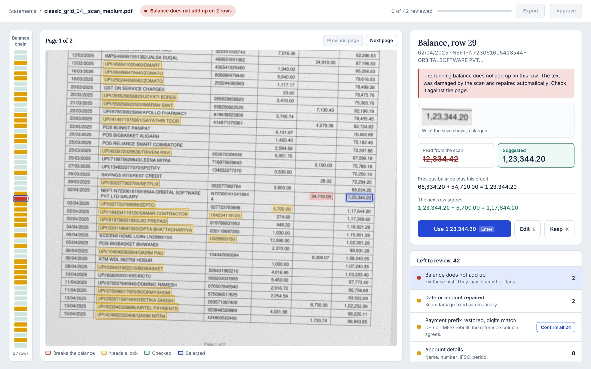

# Bank Statement Intelligence

Extract transactions from bank statements (digital PDFs and messy scans), score how much to trust
every field, and send only the uncertain ones to a human reviewer. Corrections feed an evaluation loop.

> **Status:** synthetic data with ground truth, digital-PDF and scan extraction, reconciliation-based
> confidence scoring, an evaluation harness, an OCR engine benchmark, an HTTP API, a React review screen and
> an optional local-LLM fallback (Ollama). Natural-language queries, Docker and a demo video are next.

All data in this repository is **synthetic**. Banks, people, accounts and IFSC codes are fictional,
and every generated page is stamped as a sample. No real customer data is used or needed.

## Results

Digital PDFs, 24 documents, 1,689 transactions, 4 layouts — reproduce with
`python -m stmtai.evaluate --data data/synthetic --kind digital`:

| Metric | Result |
|---|---|
| Row recall / precision | 100% / 100% |
| Transaction field accuracy | 100% (7,838 fields) |
| Account-field accuracy | 100% (240 fields) |
| Documents extracted exactly | 100% |

Extraction is exact because these PDFs carry a reliable text layer, so the number that matters is the
one below: whether the confidence scoring finds errors once they exist. `python -m stmtai.robustness`
corrupts known-correct fields by digit-sized amounts and asks the scorer to find them.

| Errors per doc | Injected | Field detection | Row detection | Fields sent to review |
|---|---|---|---|---|
| 1 | 24 | 100.0% | 100.0% | 0.5% |
| 3 | 71 | 98.6% | 98.6% | 1.4% |
| 6 | 141 | 95.0% | 97.2% | 2.6% |
| 10 | 233 | 86.3% | 93.1% | 3.9% |

Reading this: with a realistic error rate, a reviewer checks **under 2% of fields** and sees
**98-99% of the errors**. Detection degrades as errors crowd together, which is the honest result —
see *Known limitations*.

## Scans (OCR path)

Scans go through RapidOCR (PP-OCRv3 on ONNX Runtime: CPU, pip-only), are deskewed from the OCR boxes, and
feed the same table extractor in a tolerant mode (wider column tolerance, fuzzy headers, repair of
damaged dates and amounts, missing columns inferred from content). Results on the same 8 / 12 / 12
synthetic documents per severity (`python -m stmtai.evaluate --data data/synthetic --kind scan_medium`):

| Scan severity | Rows found (recall) | Financial-field accuracy | All-field accuracy | Header | Balance chain closes |
|---|---|---|---|---|---|
| light (flatbed) | 100% | 100% | 99.6% | 100% | 100% of docs |
| medium (phone photo) | 100% | 99.6% | 97.8% | 87.5% | 67% of docs |
| heavy (poor photocopy) | 55% | 34.9% | 28.2% | 11.7% | 0% of docs |

*Financial fields* are date, debit, credit and balance. Free-text description character accuracy is 99.9% /
99.5% / 32.2% for light / medium / heavy.

**Heavy scans fail, and that is reported rather than tuned away.** The engine drops and swaps digits at
that degradation, so rows are lost and values are wrong. The confidence scoring does its job (96.6% of wrong
fields are flagged), but 90% of fields end up in review, which means the document needs manual entry, not
review. Image cleanup (illumination flattening, denoising, gamma, upscaling) did not help: an aggressive
contrast stretch made it worse by fusing neighbouring digits. The default is therefore no preprocessing.
Step 4 benchmarks other engines on the same scans.

**What the reviewer sees on light/medium scans.** Two things that were hurting review load were fixed:
value dates are now verified against the row's transaction date (review load on that field fell from
about 95% to 1%), and free text uses its own threshold. OCR confidence is a blunt instrument for
descriptions, so the threshold (0.80) was chosen on a *held-out* set generated with a different seed
(`python -m stmtai.calibrate`), not on the data reported above:

| Description threshold | Review load | Description errors caught |
|---|---|---|
| 0.80 (default) | 36% | 62.5% |
| 0.90 | 69% | 83.9% |
| 0.95 | 99.5% | 100% |

Overall on medium scans, 13.9% of fields go to review and 73.9% of wrong fields (68 of 92) are caught.
Of the 24 misses, 21 are descriptions, 2 are account numbers and 1 is the opening balance; all 3 wrong
running balances and all 7 wrong dates were flagged. The threshold is a product dial: set it to 0.90 when
text accuracy matters more than reviewer time.

**Suggested corrections.** When the balance chain pins an error to one cell, the scorer proposes the value
that would close it, but never overwrites what was read. A suggestion is only offered if it is within two
digit edits of the OCR reading (otherwise the row is flagged `possible_missing_row`). On medium scans all
3 suggestions were right; on heavy scans corroborated suggestions were right 62.5% of the time, so
accepting them automatically would do net harm. Suggestions are for the reviewer, not for auto-apply.

**Domain text rule.** OCR reads `UPI/` as `UP/` or `UPV` confidently and consistently, which no confidence
threshold can catch. A small lexicon of Indian payment-rail prefixes (UPI, IMPS), applied only when a
10-13 digit reference follows, restores them, and the digits are cross-checked against the reference
column. Every such repair is flagged `prefix_snapped`.

## OCR engine benchmark (step 4)

Two questions, kept separate: *how well does an engine read the digits* (engine-independent, scored on its
text output against ground truth) and *how well does the whole pipeline do with it* (needs word boxes).
`python -m stmtai.benchmark export --engine tesseract` then `python -m stmtai.benchmark score`.

| Engine | Scan | Amount recall | Amount precision | Date recall | Reference recall |
|---|---|---|---|---|---|
| RapidOCR (PP-OCRv3) | light | 100.0% | 95.1% | 100.0% | 100.0% |
| | medium | 98.6% | 96.1% | 98.4% | 99.8% |
| | heavy | 13.5% | 51.3% | 16.8% | 18.2% |
| Tesseract 5 (`--psm 4`) | light | 99.8% | 95.0% | 75.7% | 99.1% |
| | medium | 71.0% | 89.1% | 49.1% | 66.8% |
| | heavy | 2.8% | 14.9% | 5.5% | 0.1% |
| Tesseract + flatten + denoise | medium | 73.5% | 91.8% | 50.9% | 68.3% |
| | heavy | 5.7% | 18.9% | 6.4% | 0.8% |

Amount recall compares digits only, so it is lenient about separators on purpose: it isolates digit reading.

- RapidOCR is clearly the better engine here, and no engine reads the **heavy** scans. That severity is
  probably beyond any classical OCR and is the case for the LLM fallback in step 7.
- Tesseract's first run used `--psm 6` and read 70% of amounts on light scans; `--psm 4` reads 99.8%. Page
  segmentation mode alone moved it by 30 points, so engine comparisons are only as fair as their settings.
- Full pipeline with Tesseract (light / medium / heavy): financial-field accuracy 83.7% / 8.7% / 0.0%
  against RapidOCR's 100% / 99.6% / 34.9%. The tolerant extractor was developed against RapidOCR's output,
  so part of that gap is tuning, not just the engine.
- **Unlimited-OCR** (3B vision-language model) returns block-level text, not word boxes, so it can only be
  scored with the text benchmark. `notebooks/unlimited_ocr_colab.ipynb` runs it on a free GPU and writes
  the text files this benchmark reads. The notebook was run on all the scans, but the outputs were not
  brought back into the repo, so **Unlimited-OCR is not in the table**. On the heavy scans it was seen
  inventing pages that are not in the document; that was an observation, not a scored result.

## The API (step 5)

```bash
pip install -e ".[dev,ocr,api]"
python -m stmtai.api                      # http://127.0.0.1:8000, interactive docs at /docs
```

| Endpoint | What it does |
|---|---|
| `POST /statements` | Upload a PDF. Returns `202` at once; extraction (and OCR for scans) runs in the background. |
| `GET /statements/{id}` | Status, page sizes, every field with value, confidence, flags, bounding box and suggestion. |
| `GET /statements/{id}/review` | Only the fields that need a human, each with plain-language reasons and a group. `?order=confidence` for worst first. |
| `POST /statements/{id}/corrections/bulk` | Confirm a whole low-risk group at once. Risky groups are refused. |
| `GET /statements/{id}/pages/{n}.png` | The page image the boxes are drawn on. |
| `POST /statements/{id}/corrections` | `confirm`, `correct` (with a value) or `accept_suggestion` for one cell. Returns how many cells still need review. |
| `DELETE /statements/{id}/corrections/{cid}` | Undo. |
| `POST /statements/{id}/approve` | Sign off. Refused (`409`) while cells still need review, unless `?force=true`. Approved statements are frozen until reopened. |
| `GET /statements/{id}/export.csv` / `.json` | Corrected data, with a header saying how many fields were never reviewed. |
| `GET /feedback` | How well the confidence scores matched what reviewers actually did. |

Design decisions worth knowing:

- **The raw extraction is stored once and never modified.** Every view is rebuilt as *raw, then human
  corrections, then re-score*. So fixing one wrong balance re-runs the balance check and clears the flags it
  caused on neighbouring rows, instead of leaving a stale queue. Corrections are an append-only log; undo is
  deleting a row.
- **The correction log is evaluation data.** It records what the reviewer saw (value, confidence, flags,
  whether it was flagged) and what they did. `/feedback` turns that into flag precision (of flagged cells a
  human looked at, how many were really wrong), suggestion accept rate, and *unflagged cells that still needed
  correcting*. The last number is a lower bound, since reviewers mostly look at flagged cells.
- **Safe by default for a local service:** PDFs only (checked by content, not extension), size limit
  (`STMTAI_MAX_UPLOAD_MB`, default 25), optional `X-API-Key` (`STMTAI_API_KEY`), CORS limited to the Vite dev
  server (`STMTAI_CORS_ORIGINS`). Storage is SQLite plus files under `data/api/`.

Limitations, stated plainly: extraction runs in a background thread of one process (fine for a demo or a
small team, not a queue for thousands of documents); a row the OCR dropped entirely can be detected but not
inserted yet; there is no user model, so corrections are not attributed to a person.

## The review screen (step 6)



```bash
python -m stmtai.api            # terminal 1: the API on :8000
cd web && npm install && npm run dev      # terminal 2: the UI on http://localhost:5173
```

What the screen is built around: a reviewer should spend their time on the cells that are actually in doubt,
and should never have to work out *why* a cell is flagged.

- **The page with boxes** (red: breaks the balance, yellow: needs a look, green: checked) scrolls to the
  selected cell. A strip down the left shows the balance chain, one mark per row, so a break is visible at a glance.
- **One cell at a time**, with the scan enlarged next to what the OCR read, the suggested value, and the sum
  behind it: *previous balance + this credit = suggested; the next row agrees.* The reviewer is checking
  arithmetic against the page, not trusting a model.
- **Grouped queue, worst first.** Balance breaks come first because fixing one often clears other flags.
  Low-risk groups, such as 24 restored `UPI/` prefixes whose digits match the reference column, get **Confirm all**,
  and each cell is still logged separately so the feedback metrics stay honest.
- **Keyboard first:** Enter accepts, E edits, K keeps, arrows move, U undoes. Every action can be undone.
- **Approve is locked until the queue is empty**; approved statements are frozen until reopened.

Verified two ways: 12 unit tests for the arithmetic, queue ordering and geometry (`npm test`), and an
end-to-end run in a real browser against the real API (`node web/e2e/smoke.mjs <scan.pdf>`) that uploads a
scan, accepts a suggestion, undoes it, bulk-confirms, rejects bad input, works the queue to zero, approves and
exports.

Not built yet: inserting a row the OCR dropped, per-user accounts, and drawing a box to re-read a region.

## The LLM fallback (step 7)

Arithmetic settles money: a wrong amount or balance gets a suggestion that the next row confirms. It says
nothing about *text*. What is left after scoring is mostly a merchant or person's name the OCR got wrong by a
character (`RCTC` for `IRCTC`, `DECATHL.N`) and dates it could not parse (`17Jut2026`). That is where a
language model is useful, so a local one (Ollama, nothing leaves the machine) is asked about those cells and
only those.

The model is a **proposer, not an authority**. Its answer becomes a suggestion only if the document itself
backs it up:

| field | the checks |
|---|---|
| description | digits identical to what was read (the rules may turn a 0 inside a word back into O; the reference number is never touched), payment prefix kept, at most 3 character edits, not merely a spacing or case change |
| date | every number visible in the scan is part of the proposed date; it sits between the previous and next transaction dates and inside the statement period; a month written in letters matches |
| money, references | never asked |

A suggestion never overwrites the value read, is flagged `llm_suggested`, gets its own review group
(*Suggested text corrections*, never bulk-confirmable), and is logged so `/feedback` reports the **accept
rate of model suggestions separately from arithmetic ones**. If Ollama is down or the model is not pulled,
the statement is extracted and scored exactly as before and `meta.llm` says why.

```bash
ollama pull qwen2.5:3b                           # ~1.9 GB, fits a 4 GB GPU
set STMTAI_LLM=ollama:qwen2.5:3b                 # Windows cmd; use export on macOS/Linux
python -m stmtai.api                             # uploads now go through the fallback

python -m stmtai.llm.evaluate --kind scan_medium --limit 12     # measure it against the ground truth
```

The evaluation reports, per field, cells **fixed**, correct cells **put at risk** ("broke"), and what the
checks blocked, including how many blocked answers would have broken a correct cell. Replies are cached in
`data/llm_cache`, so re-running costs nothing. See `docs/ollama.md` for setup.

What this step found before any model ran: the UPI prefix repair was swallowing the first digit of the
reference number when OCR merged `I/` into one character (`UPV160733754330`). A greedy regex was the cause,
and 20 of the 58 wrong descriptions flagged on the medium scans came from it. It is fixed in plain code,
with a test, because a model should not be used to paper over a bug.

**First real run, and what it changed.** `qwen2.5:3b` on 12 medium scans: 15 cells asked about, 2 fixed, 0 correct
cells put at risk, about 11 s per call on a 4 GB GPU. The raw answers (`answers.jsonl`) showed why the gain was
small. The errors that remain after arithmetic are mostly the letter O read as a zero (`P00JAPUROHIT`,
`B00KMYSHOW`), a space read as a dot (`RELIANCE.SMART`) and month names that lost a letter (`29-Ju-26`). The
model left the zeros alone, because the prompt (rightly) forbade changing digits, and fixed the dot and the
month. All three are exact rules, so **rules now run first** (`stmtai/llm/rules.py`): look-alike digits inside
a word, dots between letters, a lost `/` separator, and month names resolved by the neighbouring dates. They
only touch the name part of a payment description, never the reference digits, and leave handles like
`rahul123` alone. The model is asked only about what the rules cannot settle. Rule proposals are suggestions
too, flagged `rule_suggested` and checked by the same validators.

`python -m stmtai.llm.evaluate --no-model` scores the rules alone (no Ollama needed); without the flag the
report splits rule fixes from model fixes, so the model has to earn its place.

**Second and third runs: what was measured, and what it means.**

| run | cells asked | wrong before | fixed by rules | fixed by the model | correct cells put at risk |
|---|---|---|---|---|---|
| 12 medium scans, rules written after reading their errors (so in-sample) | 15 | 8 | 8 | 0 | 0 |
| 8 held-out medium scans (new seed), local OCR | 4 | 1 | 0 | 0 | 0 |
| same held-out kind of data, a noisier OCR build | 199 | 25 | 7 | not run | 0 |

Read this plainly. The rules are safe (nothing correct was ever made worse) and exact where they apply, but the
100% in the first row is in-sample and says little. On held-out data the local OCR output was clean enough that
almost nothing needed a text suggestion, and on the noisier OCR build the rules fixed all the dates but only
about one in five wrong descriptions; the rest are letters the OCR dropped outright (`WRIDESHVALA`), which no
text rule can restore. **The 3B model, reading text alone, fixed nothing beyond the rules in any run**, so the
fallback stays **off by default** (`STMTAI_LLM` unset) and is kept as a measured, optional component rather than
a claimed improvement. The harness that produced this finding is the useful part: it will show immediately if
a larger model, or a vision model that rereads the cell image, does better.

Limits, stated plainly: a wrong one-letter edit that keeps the digits and the prefix passes every check, so
the reviewer is still the safety net and the accept rate is the metric to watch. Heavy scans fail earlier than
this step (no table is found), so neither rules nor a text model reach them. Letters the OCR dropped entirely
(`WRIDESHVALA`) are beyond both rules and a 3B model reading text alone; reading the pixels again with a vision
model is the next thing to try.

## How confidence works

The running balance is the strongest correctness signal a statement has:
`previous balance + credit - debit` must equal the printed balance on every row. The chain continues
from each row's *stated* balance, so one bad row does not poison every row after it, and the **pattern**
of breaks localizes the error by arithmetic rather than guesswork:

- a balance wrong by `d` inflates its own row's difference by `+d` and the next row's by `-d`, so an
  adjacent pair that **cancels exactly** means the first row's *balance* is wrong;
- adjacent breaks that do **not** cancel are two independent errors, reported separately;
- a lone break means that row's *amount* is wrong;
- a break on the last row is genuinely ambiguous, so both fields are flagged.

Dates are checked for ordering and against the statement period. Anything scoring below `0.90` goes to
human review. Every field keeps its bounding box, so the review UI can highlight it on the page image.

## Known limitations

- **Two consecutive wrong balances** defeat exact-field attribution: the deltas no longer cancel, so both
  rows are blamed on their amount instead. The rows are still flagged, which is why row detection stays
  above field detection in the table.
- **Compensating errors are invisible.** If an amount and a balance are wrong by the same amount in the
  same direction, the chain still closes. No arithmetic check can catch this; only OCR confidence or a
  second reading can.
- **Heavy scans are not usable** with the current engine (see above). Results are on synthetic degradation,
  which approximates but is not a real phone camera; treat them as relative, not absolute, numbers.
- **Scan evaluation uses 32 scans.** Percentages on the heavy and light sets rest on few documents.
- A missing row (OCR dropped a whole line) is detected through the balance chain but cannot be rebuilt.
- **LLM suggestions are unverified guesses by nature.** The checks catch changed digits, lost prefixes and
  impossible dates, not a plausible wrong letter. Only the reviewer's accept rate says whether a model is worth using.

## Quickstart

```bash
pip install -e ".[dev,ocr]"          # [ocr] installs RapidOCR; digital PDFs work without it
python -m stmtai.synth.generate --out data/synthetic --per-layout 6 --seed 42
python -m stmtai.evaluate   --data data/synthetic --kind digital --out data/runs/digital
python -m stmtai.robustness --data data/synthetic --out data/runs/digital
python -m stmtai.evaluate   --data data/synthetic --kind scan_light --out reports/scan-light   # slow first run: OCR is cached
pytest
```

```python
from stmtai.extract.pipeline import extract_pdf
from stmtai.extract.scoring import review_items

ext = extract_pdf("samples/classic_grid_00.pdf")
print(ext.meta["summary"])          # rows, chain breaks, whether it reconciles
for row, field, conf, flags in review_items(ext):
    print(row, field, conf, flags)  # what a human needs to check
```

## The synthetic data

Evaluation needs ground truth. Because the generator knows every true value, the project reports exact
field-level accuracy per layout and per scan quality — which real statements could not give without
manual labelling, and without handling personal data.

Four deliberately different layouts, each tied to a fictional bank:

| Layout | Page | Columns / quirks |
|---|---|---|
| `classic_grid` | A4 portrait | Full grid, Indian digit grouping (`1,23,456.00`), separate Ref column, wrapped refs |
| `modern_zebra` | A4 portrait | Zebra rows, `dd Mon yyyy` dates, western grouping, summary box that must be ignored |
| `drcr_single_amount` | A4 portrait | One amount column with `Dr`/`Cr` suffixes, balance suffixed `Cr` |
| `wrapped_two_date` | A4 landscape | Transaction + value dates, wrapped descriptions, opening/brought-forward/carried-forward/closing rows |

Every digital PDF can also be turned into **scans** (image-only PDFs, no text layer) at three severities:
`light` (flatbed), `medium` (phone photo, skew + perspective + uneven light), `heavy` (poor photocopy).

## How extraction works

No layout-specific code. The extractor finds the table header band, turns each header cell into a column,
and assigns every later word to a column by its x position. A line with a date in the date column starts a
transaction; a line with neither date nor amount is a wrapped continuation; a line with amounts but no date
is a marker (opening / carried-forward / closing). Single `Amount` columns are resolved to debit or credit
from the direction the balance moved, and `Dr`/`Cr` suffixes are honoured where present.

This generalizes: adding a fifth layout should need no new code, and the evaluation harness will say
whether that held.

## Roadmap

1. [x] Synthetic statement generator with ground truth
2. [x] Digital extraction, confidence scoring, evaluation + robustness harness
3. [x] Scan path: deskew, OCR with confidence, tolerant table reconstruction, calibration
4. [x] Benchmark OCR engines on the same labelled scans: RapidOCR and Tesseract scored; Unlimited-OCR run on Colab but not scored (see the benchmark section)
5. [x] FastAPI service: upload, review queue, corrections with undo, approval, export, feedback metrics
6. [x] React review UI: page with boxes, one-cell focus with the arithmetic, grouped queue, bulk confirm, undo, approval
7. [x] Text and date suggestions: exact rules plus an optional Ollama fallback, both checked against the document, with an evaluation harness. Measured result: the rules help, the 3B text model adds nothing yet (off by default)
8. [ ] Natural-language query layer over approved statements
9. [ ] Docker and a demo video

## Layout of the repo

```
src/stmtai/
  schema.py        Pydantic models (Transaction, Statement, Label)
  reconcile.py     running-balance and date checks
  evaluate.py      row alignment, per-field accuracy, review-loop metrics, report CLI
  robustness.py    injected-error detection harness
  calibrate.py     per-field review threshold sweep on held-out data
  benchmark.py     engine-independent OCR text benchmark (amount/date/reference recall)
  feedback.py      flag quality measured from reviewer corrections
  llm/             rules and Ollama client, proposal checks, fallback and its evaluation (python -m stmtai.llm.evaluate)
  api/             FastAPI app, storage and view-building (raw -> corrections -> re-score)
  extract/
    digital.py     table extraction shared by both paths (header band, columns, rows, markers)
    scanned.py     OCR path; ocr.py engine wrapper, deskew, cache; preprocess.py cleanup recipes
    text.py        payment-rail prefix lexicon
    scoring.py     per-field confidence from the balance chain
    parse.py       date and money parsing
    models.py      extraction output with bounding boxes and confidences
  synth/           transactions, PDF layouts, scan degradation, dataset CLI
tests/             224 Python tests (plus 12 in web/), including negative controls for the evaluator itself
samples/           a few generated documents
web/               React + TypeScript review UI (Vite); e2e/smoke.mjs drives it in a real browser
notebooks/         Colab notebook for GPU-only OCR engines
reports/           committed output of the evaluation and robustness runs
```
